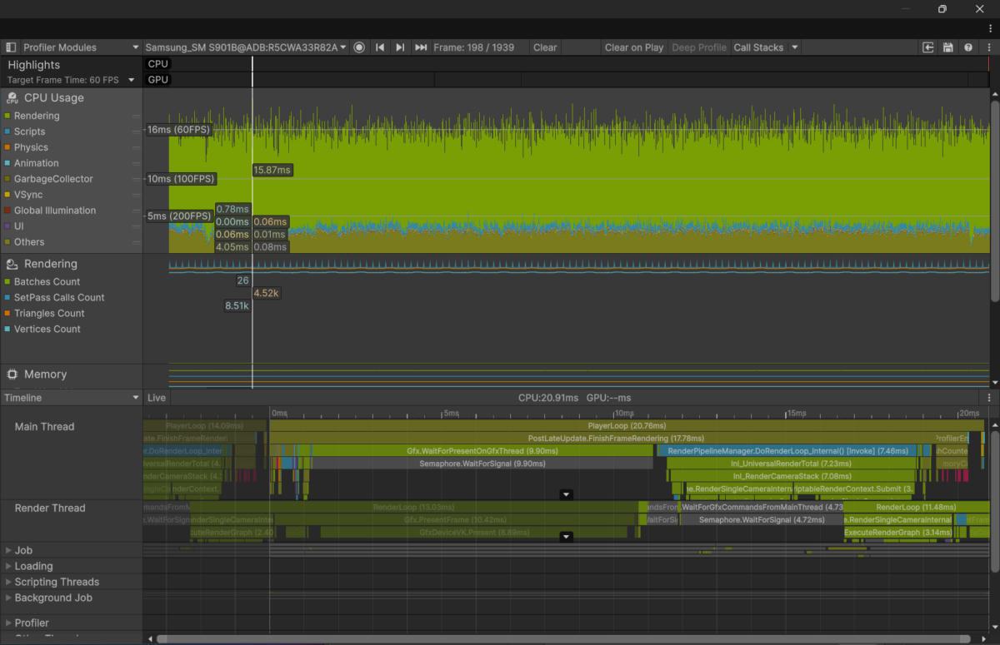
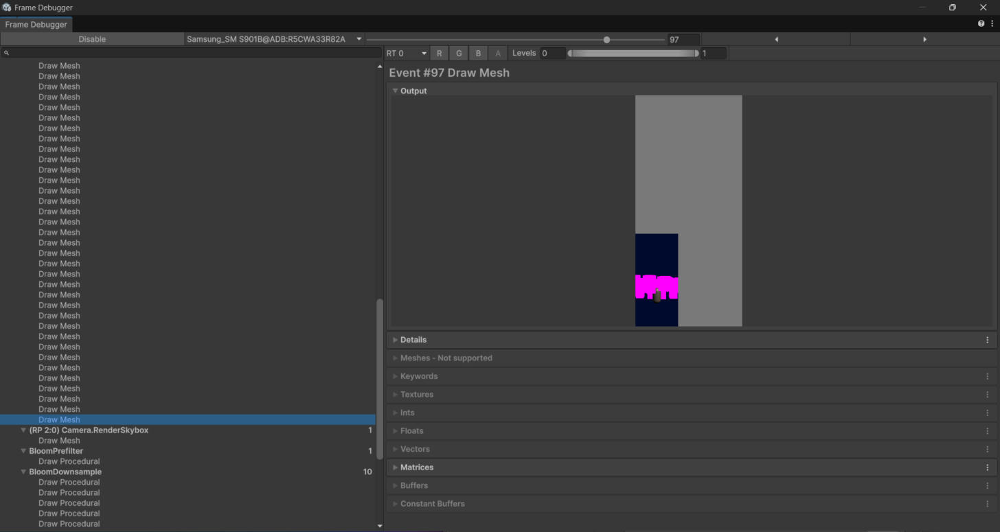

# Bottleneck 01: Week 3 baseline

Device: Samsung Galaxy S22 (SM-S901B), Exynos 2200 / Xclipse 920, Android 16, Vulkan
Build: Android Dev profile (Development Build, Autoconnect Profiler, no Deep Profiling), IL2CPP
Scene / worst case: SampleScene with the 200-cube stress test (StressCubes) running, 32 s capture (1,939 frames), 2026-11-01

## What

The 200 stress-test cubes are drawn as 94 separate, unbatched draw calls with Unity's error shader, which makes the opaque pass the biggest piece of main-thread render work.

## Where

Frame Debugger pass `(RP 2:0) RenderLoop.Draw` (94 Draw Mesh events, shader `Hidden/InternalErrorShader`); on the CPU side it sits under `PostLateUpdate.FinishFrameRendering` > `RenderPipelineManager.DoRenderLoop_Internal()` (7.46 ms in the worst frame).

## Numbers

| Measure | Value |
|---|---|
| Main-thread time, worst frame (frame 198) | 20.91 ms |
| SetPass calls | 26 |
| Batches | 26 |
| Draws in the largest pass (Frame Debugger) | 94 |
| GC allocated in frame | 51 B (3 allocations) |
| Frame time, full render scale (0.8) | ~15.6 ms (samples 15.11 / 15.42 / 16.29) |
| Frame time, half render scale (0.4) | ~17.3 ms (samples 18.51 / 17.44 / 15.83) |
| Gfx.WaitForPresentOnGfxThread, full / half | ~7.7 ms / ~7.5 ms |

## Verdict

CPU-bound (not GPU-bound): halving the render scale from 0.8 to 0.4 did not reduce frame time (~15.6 ms vs ~17.3 ms, within frame-to-frame noise), and Gfx.WaitForPresentOnGfxThread stayed at ~7.5 ms, so the GPU is not the limit. Caveat: the game is capped at 60 fps (`Application.targetFrameRate = 60` in MobileBootstrap) and 0% of frames went over the 16.7 ms target, so both sides currently fit the budget; CPU render submission is the larger real cost.

## Fix to try

Give StressCubes one shared URP/Lit material so the cubes render correctly and the SRP Batcher can merge the 94 draws into a few batches.

## Evidence

- Profiler capture: [w03-profile.data](w03-profile.data)
- Bad frame (Timeline + Rendering): 
- Most expensive pass (Frame Debugger; AGI does not support the Xclipse GPU): 
